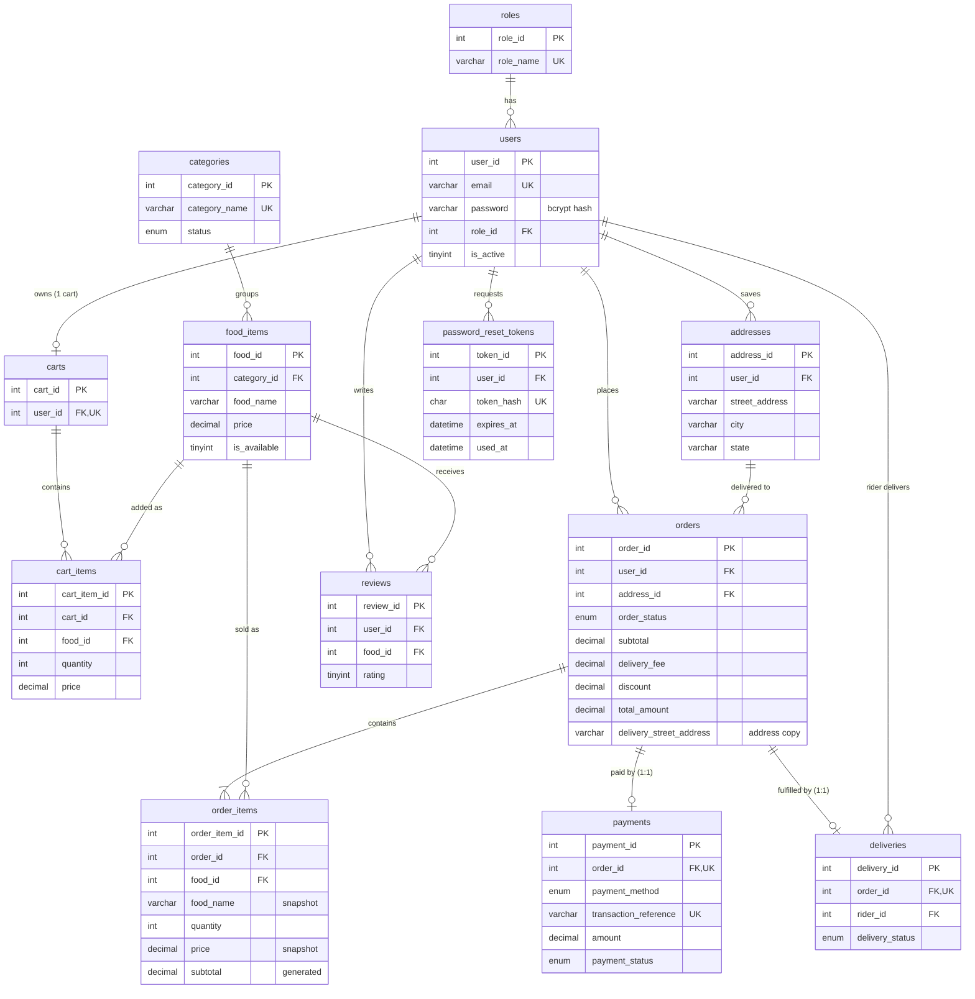

# Entity Relationship Diagram

Database: `restaurant_db` (MySQL, InnoDB, utf8mb4). Schema source of truth: `database/migrations/`.

PK = primary key, FK = foreign key, UK = unique key. `||--o|` reads "exactly one to zero or one".

## Primary keys

Every table has a single auto-increment `INT UNSIGNED` primary key named `<singular>_id` (`roles.role_id`, `users.user_id`, ...). Composite uniqueness rules (one food per cart, one review per user per food) are `UNIQUE` keys, not primary keys.

## Foreign keys

| Child table.column | Parent table.column | ON DELETE | Why |
|---|---|---|---|
| users.role_id | roles.role_id | RESTRICT | Can't delete a role that users still have |
| addresses.user_id | users.user_id | CASCADE | Saved addresses go with the user |
| carts.user_id | users.user_id | CASCADE | Cart goes with the user (UNIQUE = one cart per user) |
| cart_items.cart_id | carts.cart_id | CASCADE | Items belong to their cart |
| cart_items.food_id | food_items.food_id | CASCADE | A removed food disappears from carts |
| food_items.category_id | categories.category_id | RESTRICT | Can't delete a category that still has food |
| orders.user_id | users.user_id | RESTRICT | Order history must survive |
| orders.address_id | addresses.address_id | RESTRICT | Order history must survive (address also copied into `delivery_*`) |
| order_items.order_id | orders.order_id | CASCADE | Items belong to their order |
| order_items.food_id | food_items.food_id | RESTRICT | Sold food can't be deleted; set `is_available = 0` |
| payments.order_id | orders.order_id | RESTRICT | Financial records are never deleted (UNIQUE = 1:1) |
| deliveries.order_id | orders.order_id | RESTRICT | Delivery history is kept (UNIQUE = 1:1) |
| deliveries.rider_id | users.user_id | RESTRICT | The rider must be a real user |
| reviews.user_id | users.user_id | CASCADE | Reviews go with the user |
| reviews.food_id | food_items.food_id | CASCADE | Reviews go with the food |
| password_reset_tokens.user_id | users.user_id | CASCADE | Tokens go with the user |

All foreign keys are `ON UPDATE CASCADE`.

## Relationships in words

- **roles 1 : N users.** Each user has exactly one role (admin, staff, customer, rider).
- **users 1 : N addresses.** A customer can save several delivery addresses.
- **users 1 : 1 carts.** Enforced by `UNIQUE (carts.user_id)`.
- **carts 1 : N cart_items, food_items 1 : N cart_items.** `cart_items` links carts and foods; `UNIQUE (cart_id, food_id)` keeps one row per food.
- **categories 1 : N food_items.**
- **users 1 : N orders, addresses 1 : N orders.**
- **orders 1 : N order_items, food_items 1 : N order_items.** `order_items` links orders and foods, with the price and name snapshotted at order time.
- **orders 1 : 1 payments** and **orders 1 : 1 deliveries**, as in the project guide. Each is enforced by `UNIQUE (order_id)`. A delivery row only exists once a rider is assigned, so an order has zero or one delivery.
- **users 1 : N deliveries (as rider).** A rider has many deliveries, via `deliveries.rider_id`.
- **users N : M food_items through reviews.** One review per user per food (`UNIQUE (user_id, food_id)`).
- **users 1 : N password_reset_tokens.**
