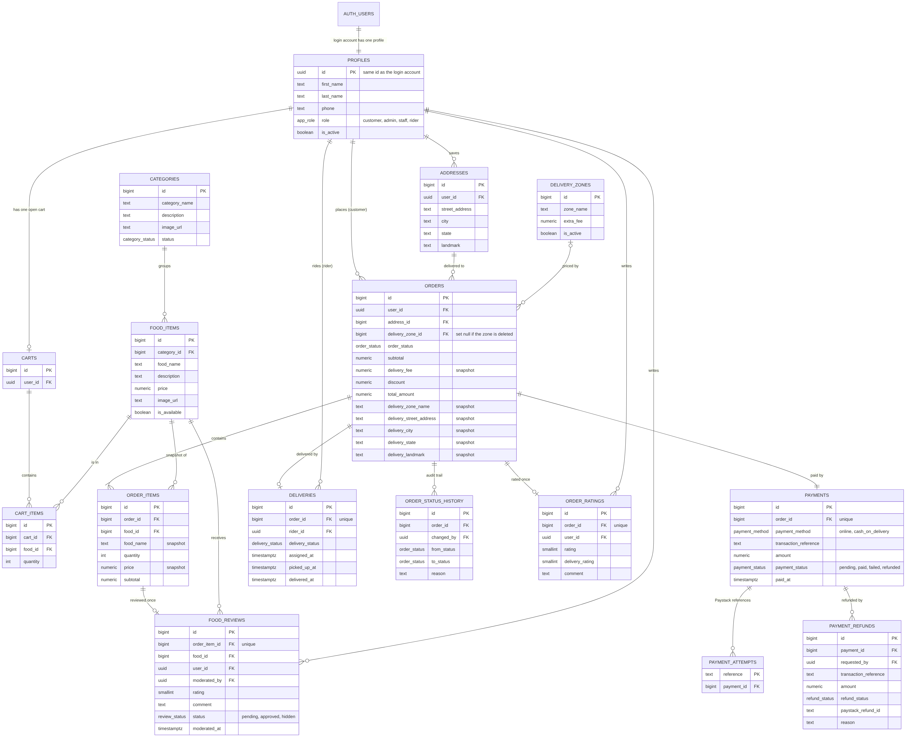

# Database diagram (Supabase / PostgreSQL)

Drawn from the live schema (the tables in the `public` schema). `er-diagram.mmd` is the editable source; the picture is
`er-diagram.png`. To redraw after a schema change: edit the `.mmd` file and run
`npx -p @mermaid-js/mermaid-cli mmdc -i docs/er-diagram.mmd -o docs/er-diagram.png -w 1800 -s 2 -b white`.

Not drawn: `created_at` / `updated_at` columns, and the `private` schema (`private.settings` holds the delivery fee,
`private.notification_outbox` queues order emails). Nothing in `private` can be reached from the browser.

## Why it is shaped this way

- **`profiles` mirrors the login account** (`auth.users`) and holds the role. Roles are read from here, never from the token.
- **Snapshots on `orders` and `order_items`** (price, food name, delivery fee, zone name, address): later menu, price or
  zone changes never rewrite history.
- **`payments`, `deliveries`, `order_ratings` are 1:1 with `orders`** (UNIQUE `order_id`); `food_reviews` is 1:1 with `order_items`.
- **`order_status_history`** records every status change and who made it.
- **`payment_attempts`** maps each Paystack reference back to its payment, so retries and webhooks match the right order.
- **`orders.delivery_zone_id` is `ON DELETE SET NULL`**: a zone can be deleted while old orders keep its name and fee.
